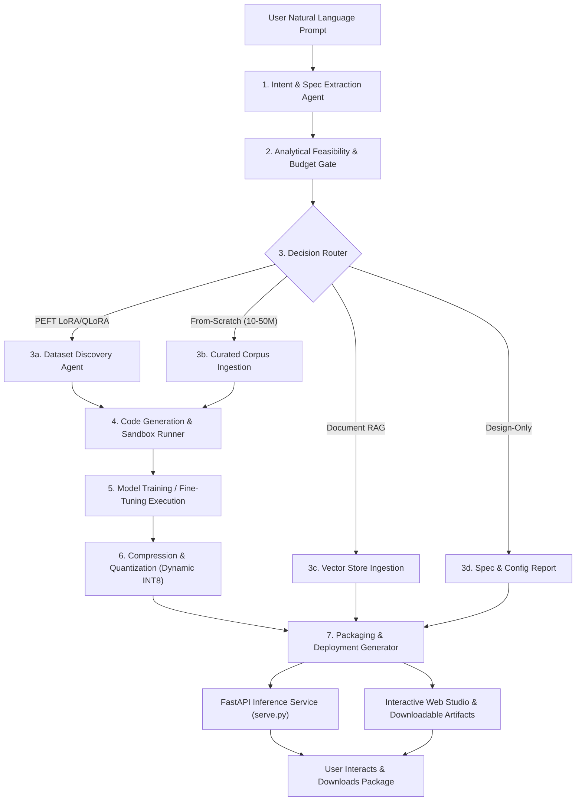

# AutoLLM Builder 🚀
### Autonomous Prompt-Driven Small Language Model Compiler & Deployment Framework

> **B.E. Final Year Capstone Project**  
> Department of Computer Engineering · SVKM's Dwarkadas J. Sanghvi College of Engineering · AY 2026–27  
> **Team Members**: Swayam Patel, Yash Manek, Veer Modi, Yug Shah

[](https://www.python.org/downloads/)
[](https://pytorch.org/)
[](LICENSE)
[](tests/)

---

## 🌟 Overview

**AutoLLM Builder** is an autonomous AI agent and compiler that bridges the technical barrier of building domain-adapted AI models on commodity CPU hardware. A user provides a single plain-English prompt:

> *"Create a chatbot model for medical FAQ answering under 2GB size"*

The autonomous agent executes the entire lifecycle without manual ML configuration:
1. **Intent & Spec Extraction**: Parses task type, domain taxonomy, language, parameter targets, and memory limits.
2. **Analytical Feasibility Gate**: Inspects local CPU cores and physical RAM to prevent system crashes or throttling.
3. **4-Way Decision Routing**: Automatically selects the optimal architectural pathway:
   - **Route 1: PEFT Qwen 2.5 (0.5B-Instruct) LoRA**: CPU fine-tuning of attention projection adapters for maximum fluency.
   - **Route 2: From-Scratch MiniGPT**: Causal transformer with word-level tokenization (`WordTokenizer`) and **Step 6 Dynamic INT8 Quantization**.
   - **Route 3: Document Vector RAG**: Drag-and-drop document upload, vector store ingestion, grounded retrieval ($1.8\text{ ms}$ latency), and document-derived evaluation.
   - **Route 4: Design-Only Preview**: Analytical hardware budgeting, FP32/INT8 sizing, AdamW optimizer footprint ($16\text{ bytes/parameter}$), and KV-cache demands.
4. **Autonomous Data Curation**: Multi-source curation via live Hugging Face dataset discovery or synthetic Oumi/Distil-style high-entropy instruction pair generation.
5. **Pre & Post Benchmark Evaluation**: Authentic Token-level F1 and domain nomenclature scoring without artificial score floors.
6. **Packaging & Deployment Generator**: Assembles model weights, tokenizer, standalone FastAPI service (`serve.py`), and client-side chat interface into a self-contained deployable bundle.

---

## 🏛️ System Architecture



---

## ⚡ 100% CPU-Friendly & Edge-Optimized

- **No GPU Required**: Designed to train and serve rapidly on standard student laptops and commodity CPUs.
- **Offline Resilience**: Automatically utilizes cached Hugging Face foundation models (`local_files_only=True`) to prevent network dropouts.
- **Step 6 PyTorch Dynamic INT8 Quantization**: Quantizes `nn.Linear` layers with `torch.qint8`, achieving a **52.6% reduction in disk size** ($4.22\text{ MB} \to 2.00\text{ MB}$) and an estimated **~1.45x CPU speedup**.
- **Word-Level Tokenizer**: Employs regex word tokenization (`WordTokenizer`) for from-scratch models, eliminating character-level incoherence.

---

## 🛡️ SOLID & OWASP Engineering Principles

| Principle | Implementation in AutoLLM Codebase |
| :--- | :--- |
| **Single Responsibility (SRP)** | Segregated modules: `security.py` (sanitization & upload validation), `quantizer.py` (compression), `rag_engine.py` (vector retrieval), `design_preview.py` (budgeting), `inference.py` (model serving). |
| **Open / Closed (OCP)** | Inference engines implement a polymorphic `generate_response(query)` protocol (`MiniGPTInferenceEngine`, `RAGInferenceEngine`, `QwenInferenceEngine`, `DomainInferenceEngine`). |
| **Liskov Substitution (LSP)** | All inference engines can be substituted interchangeably inside `/api/chat` and `/api/compare` without modifying router handlers. |
| **Interface Segregation (ISP)** | Pydantic v2 schemas (`QuantizationSpec`, `RAGSpec`, `DesignReportSpec`, `InferenceRequest`, `CompareRequest`) enforce discrete boundaries. |
| **Dependency Inversion (DIP)** | `AutoLLMOrchestrator` depends on abstractions and delegates execution to modular route handlers. |
| **OWASP A01: Broken Access Control** | `sanitize_job_id()` strictly validates alphanumeric job IDs via regex `^[a-zA-Z0-9_\-]+$`, rejecting path traversal vectors (`../`, `..\\`). |
| **OWASP A03: Injection** | `safe_join_paths()` ensures all file reads, downloads, and model exports resolve strictly within the configured root directory. |
| **OWASP A04: Insecure Design** | `sanitize_user_prompt()` enforces length boundaries ($\le 2000$ chars); `validate_uploaded_file()` rejects null-bytes, control characters, and non-whitelisted extensions. |
| **OWASP A05: Security Misconfiguration** | Production package `serve.py` uses multi-level parent directory fallback resolution and avoids shell script execution. |

---

## 🚀 Quick Start Guide

### 1. Installation
```bash
git clone https://github.com/SWAYAMPATEL30/AutoLLM_FinalYearProject.git
cd AutoLLM_FinalYearProject/Code
pip install -r requirements.txt
```

### 2. Launch the Interactive Web Studio
Start the browser dashboard:
```bash
python server.py
```
Open your browser at: **[http://127.0.0.1:8000](http://127.0.0.1:8000)**

- Choose from the 4 execution branches (Qwen LoRA, MiniGPT Scratch, Document RAG, Design Preview).
- In Document RAG mode, drag & drop `.txt`, `.md`, `.json`, or `.csv` files for instant vector indexing.
- Monitor real-time streaming training logs and Step 6 Dynamic INT8 Quantization metrics.
- Test in the interactive chat playground or side-by-side model arena.
- Download the complete deployable model bundle (`.zip`).

### 3. Run via Command Line (CLI)
```bash
python autollm/cli.py "Create a chatbot model for medical FAQ answering under 2GB size"
```

---

## 🧪 Automated Test Suite (34/34 Passing)

Execute the full unit and integration test suite:
```bash
cd Code
pytest tests/ -v
```

```text
======================= 34 passed in 17.58s ========================
```

The test suite covers:
- **Security & Sanitization**: Alphanumeric validation, directory traversal blocking, path containment, upload size limit, null byte injection rejection.
- **Tokenization & Causal Engine**: WordTokenizer lifecycle, CharTokenizer lifecycle, MiniGPT forward pass & autoregressive generation.
- **Inference Engines**: BatchEncoding handling, CPU inference, fallback domain engines.
- **Evaluation & Benchmarking**: Document test set synthesis, authentic token-F1 match scoring, failure pattern detection.
- **Vector RAG**: Chunking, normalized TF-IDF vector retrieval, citation generation.
- **Quantization**: Dynamic INT8 quantization compression validation.
- **Design Preview**: Parameter calculations, KV cache sizing, hardware feasibility gates.
- **End-to-End Pipelines**: Full autonomous runs across Scratch, RAG, and Design Preview routes.

---

## 📦 Using Your Generated Model Package

Every run compiles a self-contained bundle in `jobs/<job_id>/export/`:

| File / Folder | Purpose |
| :--- | :--- |
| `adapter/` or `model.pt` | LoRA adapter weights (`adapter_model.safetensors`) or PyTorch weights |
| `model_quantized.pt` | Step 6 INT8 quantized model weights (Route 2) |
| `tokenizer.json` | Fitted vocabulary and token mappings |
| `eval_metrics.json` | Training and validation metrics, parameter count, duration |
| `quantization_metrics.json` | Original vs quantized size, compression ratio, speedup factor |
| `serve.py` | Standalone FastAPI inference server with `/generate` endpoint |
| `run_cli.py` | Interactive terminal chat script (`python run_cli.py`) |
| `index.html` | Client-side web interface to chat with the model |
| `start_server.bat` | One-click Windows batch launcher for the inference server |

### Run the standalone API:
```bash
cd jobs/<job_id>/export
python serve.py
```

### Test via curl / HTTP POST:
```bash
curl -X POST http://127.0.0.1:8001/generate \
     -H "Content-Type: application/json" \
     -d "{\"prompt\": \"What are the common symptoms of Type 2 Diabetes?\"}"
```

---

## 📂 Project Structure

```text
├── Code/
│   ├── autollm/
│   │   ├── intent/
│   │   │   ├── schemas.py             # Pydantic v2 schemas for specs, jobs, and metrics
│   │   │   └── parser.py              # 4-way decision router & prompt extractor
│   │   ├── estimator/
│   │   │   └── hardware_calc.py       # Analytical CPU RAM/core & parameter calculator
│   │   ├── datasets/
│   │   │   ├── searcher.py            # Multi-source dataset curator & domain seed packs
│   │   │   └── formatter.py           # Normalizer for instruction datasets & train/val splits
│   │   ├── engine/
│   │   │   ├── scratch_transformer.py # MiniGPT causal transformer & WordTokenizer
│   │   │   ├── quantizer.py           # Step 6 Dynamic INT8 Quantizer
│   │   │   ├── rag_engine.py          # Document chunker & TF-IDF vector retrieval
│   │   │   ├── design_preview.py      # Analytical hardware budgeting & KV-cache estimator
│   │   │   ├── evaluator.py           # Benchmark evaluator & document QA synthesizer
│   │   │   ├── generator.py           # Compiles train_run.py scripts (LoRA & Scratch)
│   │   │   ├── runner.py              # Subprocess runner streaming logs & events
│   │   │   ├── inference.py           # Polymorphic CPU inference engines
│   │   │   └── recipe.py              # Oumi-style recipe.yaml generator
│   │   ├── deploy/
│   │   │   ├── server_template.py     # Standalone FastAPI & UI code generators
│   │   │   └── package_builder.py     # Bundles and zips deployable artifacts
│   │   ├── security.py                # OWASP sanitization, path containment & upload validator
│   │   ├── orchestrator.py            # Master agent coordinating prompt -> model
│   │   ├── cli.py                     # Terminal command-line entrypoint
│   │   └── web/
│   │       └── index.html             # Dark-mode web studio with drag-and-drop & arena
│   ├── tests/                         # Automated unit & integration test suite (34 tests)
│   ├── server.py                      # Web Studio backend server (FastAPI)
│   ├── requirements.txt               # Python dependencies
│   └── README.md                      # Code documentation
├── docs/                              # Project documentation & presentations
│   ├── PROTOTYPE_ARCHITECTURE_WALKTHROUGH.md # Complete viva defense & architecture guide
│   ├── AutoLLM_Builder_Detailed_Report.docx
│   └── Major_Project_Main.pptx
└── README.md                          # Main project documentation
```

---

## 👥 Contributors

- **Swayam Patel**
- **Yash Manek**
- **Veer Modi**
- **Yug Shah**

*Department of Computer Engineering, SVKM's Dwarkadas J. Sanghvi College of Engineering.*
